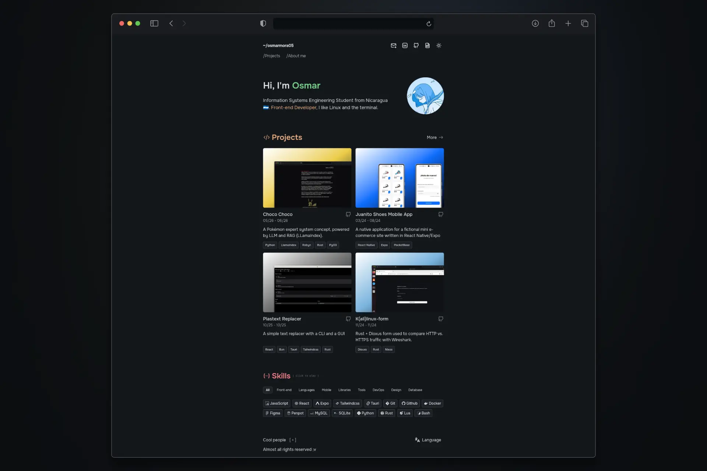

<div align="center">
    <a href="https://osmarmora05.github.io/me">
        
    </a>
    <p></p>
</div>

# 🚀 Run the project

1. Clone the project

```sh
  git clone https://github.com/osmarmora05/me
  cd me
```

2. Install dependencies & run

```sh
  pnpm i; pnpm run dev
```

## 📓 Libraries

- [astrojs/mdx](https://docs.astro.build/en/guides/integrations-guide/mdx/)
- [rexa-developer/tiks](https://github.com/rexa-developer/tiks)
- [astro](https://astro.build/)
- [cnfast](https://github.com/aidenybai/cnfast)
- [tailwindcss](https://tailwindcss.com/)

## 🖼️Styles

### Icons

- [tabler](https://tabler.io/icons)

### Fonts

- [onest.md](https://onest.md/)

## 🎮 Demo

- [Live demo here!](https://osmarmora05.github.io/me/)

## 🛠️Tech Stack

- Astro
- Tailwindcss
- JavaScript
- Git
- Penpot

## ⚖️ License

MIT
